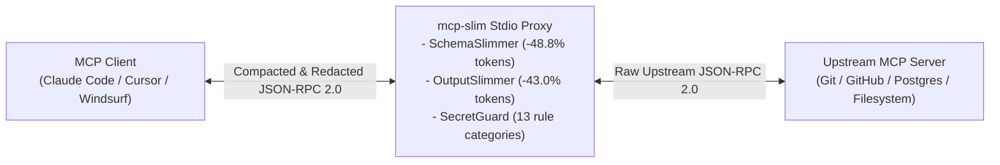

# mcp-slim

**Zero-Dependency MCP JSON-RPC 2.0 Stdio Proxy for Context Compression and Real-Time Secret Redaction**

[](https://github.com/SalyyS1/mcp-slim/actions/workflows/ci.yml)
[](https://github.com/SalyyS1/mcp-slim)
[](https://github.com/SalyyS1/mcp-slim/blob/main/pyproject.toml)
[](https://modelcontextprotocol.io)
[](https://github.com/SalyyS1/mcp-slim/blob/main/LICENSE)

---

## Overview

When connecting MCP clients (**Claude Code**, **Cursor**, **Windsurf**, **Claude Desktop**, or custom agents) to multiple Model Context Protocol (MCP) servers (`git`, `filesystem`, `postgres`, `github`, `slack`), two structural issues occur on every conversation turn:

1. **Context Window Bloat (14,000–60,000+ tokens per turn):** Auto-generated Pydantic and Zod `tools/list` JSON schemas include `$schema` declarations, redundant `title` fields, verbose multi-sentence descriptions, nullable `anyOf: [{"type": "string"}, {"type": "null"}]` wrappers, and uncompacted `tools/call` JSON responses filled with `null`, `""`, `[]`, and `{}` entries.
2. **Unfiltered Credential Exposure:** MCP tools reading logs, `.env` files, database rows, or git remotes frequently return raw API keys (`sk-ant-...`, `ghp_...`, `AKIA...`, `xoxb-...`, JWTs, or database DSNs containing passwords) directly into the LLM context window.

`mcp-slim` is a transparent, zero-dependency Python 3.10+ stdio proxy that sits between the MCP client and any upstream MCP server (`npx`, `uvx`, `python`, `docker`). It compacts `tools/list` schemas and `tools/call` payloads by **47–52%** while redacting leaked credentials bidirectionally with **sub-millisecond (`~0.93 ms` p50) overhead**.



---

## Performance & Compression Benchmarks

All benchmarks are reproducible via [`benchmarks/run_benchmarks.py`](./benchmarks/run_benchmarks.py) against [`benchmarks/fixtures/real_mcp_workload.json`](./benchmarks/fixtures/real_mcp_workload.json) (60 tool definitions across four standard MCP servers plus a 12-item GitHub repository search `tools/call` response containing leaked credentials).

### 1. Context Token & Wire-Byte Compression


| Workload | Tools | Raw Wire Bytes | Slim Wire Bytes | Tokens Before | Tokens After | Tokens Saved | Reduction |
| :--- | ---: | ---: | ---: | ---: | ---: | ---: | ---: |
| `mcp-server-git` | 14 | 7,639 B | 3,959 B | 1,910 | 990 | 920 | **-48.2%** |
| `mcp-server-filesystem` | 12 | 8,017 B | 3,883 B | 2,005 | 971 | 1,034 | **-51.6%** |
| `mcp-server-postgres` | 8 | 5,069 B | 2,595 B | 1,268 | 648 | 620 | **-48.9%** |
| `mcp-server-github` | 26 | 29,323 B | 15,453 B | 7,331 | 3,864 | 3,467 | **-47.3%** |
| **Combined Workspace (60 tools + `tools/call`)** | **60** | **57,470 B** | **29,438 B** | **14,364** | **7,354** | **7,010** | **-48.8%** |

### 2. Runtime Latency, Throughput & Memory Footprint

Measured over **N = 5,000 iterations** on Python 3.11 (`linux x86_64`) using `time.perf_counter_ns()` and isolated `tracemalloc` allocation profiling:


| Pipeline Stage | Payload Size | p50 Latency | p95 Latency | p99 Latency | Throughput | Peak Heap Allocation |
| :--- | :--- | ---: | ---: | ---: | ---: | ---: |
| `SecretGuard.redact_text` | 7,450 B JSON-RPC payload | **141.2 µs** | 197.3 µs | 224.2 µs | **6,778 msg/s** (48.2 MB/s) | 22.2 KiB |
| `SchemaSlimmer.slim_tools_list` | 14 tools (7,639 B) | **671.1 µs** | 863.8 µs | 949.0 µs | **1,444 msg/s** (10.5 MB/s) | 4.7 KiB |
| `OutputSlimmer.slim_call_result` | 12-repo JSON output (7,450 B) | **462.7 µs** | 603.6 µs | 654.3 µs | **2,121 msg/s** (15.1 MB/s) | 17.1 KiB |
| `MCPProxy` Full JSON-RPC Turn | Request + Response + Slim + Guard | **930.6 µs** | 1,209.0 µs | 1,344.8 µs | **1,050 msg/s** (7.6 MB/s) | 24.4 KiB |

To reproduce these measurements and regenerate the SVG charts locally:

```bash
python3 benchmarks/run_benchmarks.py
```

---

## Installation & Quick Start

### 1. Install

`mcp-slim` requires Python 3.10+ and has zero third-party runtime dependencies:

```bash
pip install git+https://github.com/SalyyS1/mcp-slim.git
# or with uv:
uv tool install git+https://github.com/SalyyS1/mcp-slim.git
```

### 2. Wrap Existing MCP Configuration

Wrap all servers in a Claude Desktop, Claude Code, Cursor, or Windsurf configuration file with a single command:

```bash
# Preview modified configuration on stdout:
mcp-slim wrap ~/.cursor/mcp.json

# Update configuration file in-place:
mcp-slim wrap -i ~/.cursor/mcp.json
```

**Before (`mcp.json`):**
```json
{
  "mcpServers": {
    "github": {
      "command": "npx",
      "args": ["-y", "@modelcontextprotocol/server-github"]
    }
  }
}
```

**After (`mcp-slim wrap -i mcp.json`):**
```json
{
  "mcpServers": {
    "github": {
      "command": "mcp-slim",
      "args": ["run", "--", "npx", "-y", "@modelcontextprotocol/server-github"]
    }
  }
}
```

---

## Architecture & Optimization Passes

### 1. `SchemaSlimmer` (`tools/list`)
- **Metadata Stripping:** Removes `$schema`, `$id`, `title`, `additionalProperties`, `examples`, and `default` fields that do not affect LLM tool invocation accuracy.
- **Nullable Union Normalization:** Rewrites `{"anyOf": [{"type": "string"}, {"type": "null"}]}` and `{"type": ["string", "null"]}` into `{"type": "string"}` while preserving top-level `required` arrays.
- **Redundant Description Pruning:** Drops parameter descriptions that merely restate the parameter identifier or parent tool name (for example, `repo_path`: `"The path to the Git repository."`).
- **Sentence-Boundary Condensation:** Truncates multi-sentence descriptions to their primary clause (configurable via `--max-desc` and `--max-param-desc`).
- **Tool Allowlisting and Denylisting:** Filter exposed tools at the proxy boundary via `--allow-tools` or `--deny-tools`:

```bash
mcp-slim run --allow-tools search_repositories,get_file_contents -- npx -y @modelcontextprotocol/server-github
```

### 2. `OutputSlimmer` (`tools/call`)
- **JSON Compaction and Empty-Value Pruning:** Parses JSON strings inside `content[].text`, recursively removes keys with `null`, `""`, `[]`, or `{}` values, and re-serializes without indentation whitespace.
- **ANSI Escape Removal:** Strips terminal color and cursor control sequences from CLI output.
- **Collection and Text Bounding:** Caps oversized arrays (`max_list_items=50`) and multi-megabyte text payloads (`max_text_chars=16000`) with explicit truncation markers.

### 3. `SecretGuard` (Bidirectional Credential Redaction)
Uses C-level substring trigger pre-filters paired with literal-prefix anchored regular expressions (`sre` Boyer-Moore `fastsearch`) to scan both outgoing `tools/call` arguments and incoming `tools/call` results:

| Credential Category | Pattern Prefix / Structure | Redaction Replacement |
| :--- | :--- | :--- |
| Anthropic API Keys | `sk-ant-api03-...`, `sk-ant-admin01-...` | `[REDACTED:ANTHROPIC_KEY]` |
| OpenAI API & Project Keys | `sk-proj-...`, `sk-...T3BlbkFJ...` | `[REDACTED:OPENAI_KEY]` |
| GitHub PAT & Fine-Grained Tokens | `ghp_...`, `gho_...`, `ghs_...`, `github_pat_...` | `[REDACTED:GITHUB_TOKEN]` |
| AWS Access Key IDs | `AKIA...`, `ASIA...`, `ABIA...`, `ACCA...` | `[REDACTED:AWS_ACCESS_KEY]` |
| Google Cloud API Keys | `AIza...` | `[REDACTED:GCP_API_KEY]` |
| Slack Bot & User Tokens | `xoxb-...`, `xoxp-...`, `xoxa-...`, `xoxr-...` | `[REDACTED:SLACK_TOKEN]` |
| Stripe Live & Restricted Keys | `sk_live_...`, `rk_live_...`, `sk_test_...` | `[REDACTED:STRIPE_KEY]` |
| HuggingFace User Access Tokens | `hf_...` | `[REDACTED:HF_TOKEN]` |
| PEM / OpenSSH Private Keys | `-----BEGIN ... PRIVATE KEY-----` | `[REDACTED:PRIVATE_KEY_BLOCK]` |
| JSON Web Tokens (JWT) | `eyJ...` (3-segment base64url) | `[REDACTED:JWT_TOKEN]` |
| URI Userinfo Passwords | `://user:password@host` | `[REDACTED:URL_SECRET]` |
| Environment Variable Secrets | `API_KEY=...`, `DB_PASSWORD=...`, `CLIENT_SECRET=...` | `[REDACTED:ENV_SECRET]` |

---

## Testing

Run the unit test suite and benchmark verification:

```bash
PYTHONPATH=src python3 -m unittest discover -s tests -v
python3 benchmarks/run_benchmarks.py
```

---

## License

Released under the [MIT License](./LICENSE).

---

## Related AI Infrastructure Projects by [@SalyyS1](https://github.com/SalyyS1)

- **[loraspectra](https://github.com/SalyyS1/loraspectra)** — Zero-dependency Rust engine & CLI for auditing spectral rank collapse, dynamically compressing `.safetensors` LoRA adapters by **-83.8%** at **99% Frobenius energy**, and merging conflicting adapters via QR-Core Orthogonal Subspace Projection (`1,050x–2,680x` faster than dense SVD).
