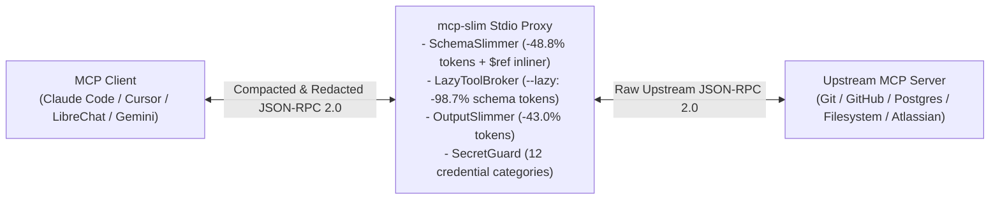

# mcp-slim

**Zero-Dependency MCP JSON-RPC 2.0 Stdio Proxy for Context Compression (-48.8% to -98.7% Tokens), Cross-LLM `$ref` Inlining, On-Demand Tool Discovery, and Real-Time Secret Redaction**

[](https://github.com/SalyyS1/mcp-slim/actions/workflows/ci.yml)
[](https://github.com/SalyyS1/mcp-slim)
[](https://github.com/SalyyS1/mcp-slim/blob/main/pyproject.toml)
[](https://modelcontextprotocol.io)
[](https://github.com/SalyyS1/mcp-slim/blob/main/LICENSE)

---

## Overview

When connecting MCP clients (**Claude Code**, **Cursor**, **Windsurf**, **Claude Desktop**, **LibreChat**, **Cherry Studio**, or custom agents) to multiple Model Context Protocol (MCP) servers (`git`, `filesystem`, `postgres`, `github`, `atlassian`, `slack`), three structural bottlenecks degrade agent reliability on every conversation turn:

1. **Context Window Bloat & Tool Selection Rot (14,000–60,000+ tokens per turn):** Auto-generated Pydantic and Zod `tools/list` JSON schemas include `$schema` declarations, redundant `title` fields, verbose multi-paragraph descriptions, nullable `anyOf: [{"type": "string"}, {"type": "null"}]` wrappers, and uncompacted `tools/call` JSON responses filled with `null`, `""`, `[]`, and `{}` entries.
2. **Cross-Provider Schema Rejections (`$defs` / `$ref`):** FastMCP and Pydantic servers emit nested `"$defs"` and `{"$ref": "#/$defs/..."}` pointers inside `inputSchema`, triggering `400 Invalid Argument` errors on Google Gemini, Vertex AI, Azure OpenAI, and local vLLM/Ollama function-calling endpoints.
3. **Unfiltered Credential Exposure:** MCP tools reading logs, `.env` files, database rows, or git remotes frequently return raw API keys (`sk-ant-...`, `ghp_...`, `AKIA...`, `xoxb-...`, JWTs, or database DSNs containing passwords) directly into the LLM context window.

`mcp-slim` is a transparent, zero-dependency Python 3.10+ stdio proxy that sits between any MCP client and upstream MCP server (`npx`, `uvx`, `python`, `docker`). It operates in two selectable modes:
- **Standard Mode (`mcp-slim run -- ...`):** Compacts all exposed `tools/list` schemas and `tools/call` payloads in-place by **47–52%**, inlines `$defs`/`$ref` pointers, and filters tools via exact names or wildcard globs (`--allow-tools "get_*,search_*"`).
- **Lazy Discovery Mode (`mcp-slim run --lazy -- ...`):** Replaces 40–100+ static tool definitions with 2 lightweight on-demand meta-tools (`mcp_search_tools` with BM25 ranking and `mcp_call_tool`), cutting static `tools/list` schema tokens from `12,512` to `168` (**-98.7%**) on any MCP client.



---

## Comparison with Existing Approaches

| Capability | Raw MCP Server | `mcp-filter` | Atlassian `mcp-compressor` | Claude Native `ToolSearch` | **`mcp-slim` (`v0.4.0`)** |
| :--- | :---: | :---: | :---: | :---: | :---: |
| **Runtime Dependencies** | Varies | Node.js | Python + deps | Built into Claude Code only | **0 (Pure Python 3.10+ stdlib)** |
| **Static `tools/list` Schema Minification** | No | No | Yes | No | **Yes (-48.3% to -51.6% tokens)** |
| **On-Demand Lazy Meta-Tool Discovery (`--lazy`)** | No | No | Yes | Client-locked | **Yes (-98.7% tokens, works on any client)** |
| **KV-Cache & Prompt-Cache Prefix Stabilization** | No | No | No | No | **Yes (Canonical tool & property sorting)** |
| **Schema-Guided Argument Type Coercion (`tools/call`)** | No | No | No | No | **Yes (Auto-coerces stringified int/float/bool/JSON)** |
| **Wildcard Glob Tool Filtering (`get_*,search_*`)** | No | Exact names | No | No | **Yes (`--allow-tools` / `--deny-tools`)** |
| **`$defs` / `$ref` Inlining (Gemini / Vertex / Azure fix)** | No | No | No | No | **Yes (Recursive with cycle guard)** |
| **`tools/call` Valid-JSON Budget & Markdown Table Compaction** | No | No | No | No | **Yes (-43%+ output tokens, never breaks JSON)** |
| **Read-Only Tool Call TTL Cache (`--cache-ttl`)** | No | No | No | No | **Yes (Auto-invalidated on mutations)** |
| **Secret Redaction & Tool-Poisoning / Prompt-Injection Shield** | No | No | No | No | **Yes (13 categories, `141 µs` p50)** |
| **Live Stdio Server Inspector (`mcp-slim inspect`)** | No | No | No | No | **Yes (`mcp-slim inspect -- <cmd>`)** |

---

## Performance & Compression Benchmarks

All benchmarks are reproducible via [`benchmarks/run_benchmarks.py`](./benchmarks/run_benchmarks.py) and `mcp-slim audit benchmarks/fixtures/real_mcp_workload.json` against [`benchmarks/fixtures/real_mcp_workload.json`](./benchmarks/fixtures/real_mcp_workload.json) (60 tool definitions across four standard MCP servers plus a 12-item GitHub repository search `tools/call` response containing leaked credentials).

### 1. Context Token & Wire-Byte Compression


| Workload | Tools | Raw Wire Bytes | Slim Wire Bytes | Tokens Before | Tokens After | Tokens Saved | Reduction |
| :--- | ---: | ---: | ---: | ---: | ---: | ---: | ---: |
| `mcp-server-git` | 14 | 7,639 B | 3,959 B | 1,910 | 990 | 920 | **-48.2%** |
| `mcp-server-filesystem` | 12 | 8,017 B | 3,883 B | 2,005 | 971 | 1,034 | **-51.6%** |
| `mcp-server-postgres` | 8 | 5,069 B | 2,595 B | 1,268 | 648 | 620 | **-48.9%** |
| `mcp-server-github` | 26 | 29,323 B | 15,453 B | 7,331 | 3,864 | 3,467 | **-47.3%** |
| **Combined Workspace (Standard Mode)** | **60** | **57,470 B** | **29,438 B** | **14,364** | **7,354** | **7,010** | **-48.8%** |
| **Combined `tools/list` (`--lazy` Discovery Mode)** | **60 -> 2** | **50,048 B** | **671 B** | **12,512** | **168** | **12,344** | **-98.7%** |

### 2. Runtime Latency, Throughput & Memory Footprint

Measured over **N = 5,000 iterations** on Python 3.11 (`linux x86_64`) using `time.perf_counter_ns()` and isolated `tracemalloc` allocation profiling:


| Pipeline Stage | Payload Size | p50 Latency | p95 Latency | p99 Latency | Throughput | Peak Heap Allocation |
| :--- | :--- | ---: | ---: | ---: | ---: | ---: |
| `SecretGuard.redact_text` | 7,450 B JSON-RPC payload | **141.2 µs** | 197.3 µs | 224.2 µs | **6,778 msg/s** (48.2 MB/s) | 22.2 KiB |
| `SchemaSlimmer.slim_tools_list` | 14 tools (7,639 B) | **671.1 µs** | 863.8 µs | 949.0 µs | **1,444 msg/s** (10.5 MB/s) | 4.7 KiB |
| `OutputSlimmer.slim_call_result` | 12-repo JSON output (7,450 B) | **462.7 µs** | 603.6 µs | 654.3 µs | **2,121 msg/s** (15.1 MB/s) | 17.1 KiB |
| `MCPProxy` Full JSON-RPC Turn | Request + Response + Slim + Guard | **930.6 µs** | 1,209.0 µs | 1,344.8 µs | **1,050 msg/s** (7.6 MB/s) | 24.4 KiB |

---

## Installation & Quick Start

### 1. Install

`mcp-slim` requires Python 3.10+ and has zero third-party runtime dependencies:

```bash
pip install git+https://github.com/SalyyS1/mcp-slim.git
# or with uv:
uv tool install git+https://github.com/SalyyS1/mcp-slim.git
```

### 2. Wrap Existing MCP Configuration (`Standard` or `--lazy`)

Wrap all servers in a Claude Desktop, Claude Code, Cursor, or Windsurf configuration file with a single command:

```bash
# Standard schema slimming (-48.8% tokens):
mcp-slim wrap -i ~/.cursor/mcp.json

# Or enable On-Demand Lazy Discovery (-98.7% static schema tokens):
mcp-slim wrap --lazy -i ~/.cursor/mcp.json
```

### 3. Inspect a Live MCP Server or Static Schema Manifest

Spawn any live MCP server over stdio, perform the JSON-RPC `initialize` + `tools/list` handshake automatically, and audit its token consumption without an LLM client:

```bash
# Live stdio server inspection (no chat session or API key required):
mcp-slim inspect -- npx -y @modelcontextprotocol/server-filesystem /tmp

# Or audit a static tools JSON manifest:
mcp-slim audit benchmarks/fixtures/real_mcp_workload.json
```

Output:
```text
mcp-slim Schema Audit (60 tools)
==============================================================================
TOOL NAME                        |   RAW TOK |  SLIM TOK |     SAVED |   $REF
------------------------------------------------------------------------------
git_status                       |        80 |        43 |    -46.2% |     ok
git_log                          |       272 |       108 |    -60.3% |     ok
read_file                        |       238 |       110 |    -53.8% |     ok
... (40 additional tools omitted from row listing)
------------------------------------------------------------------------------
Standard SchemaSlimmer : 12512 -> 6470 tokens (-48.3%, inlined 0 $ref definitions)
Lazy Discovery (--lazy): 12512 -> 168 tokens (-98.7% via 2 on-demand meta-tools)
==============================================================================
```

---

## Architecture & Optimization Passes

### 1. `SchemaSlimmer` (`tools/list`)
- **Recursive `$defs` / `$ref` Inlining:** Resolves local `#/$defs/...` and `#/definitions/...` JSON pointers inline and removes `$defs` blocks so Pydantic/FastMCP servers work without `400 Invalid Argument` errors on Google Gemini, Vertex AI, and Azure OpenAI.
- **Metadata Stripping:** Removes `$schema`, `$id`, `title`, `additionalProperties`, `examples`, and `default` fields that do not affect LLM tool invocation accuracy.
- **Nullable Union Normalization:** Rewrites `{"anyOf": [{"type": "string"}, {"type": "null"}]}` into `{"type": "string"}` while preserving top-level `required` arrays.
- **Redundant Description Pruning:** Drops parameter descriptions that merely restate the parameter identifier (`repo_path`: `"The path to the Git repository."`).
- **Sentence-Boundary Condensation:** Truncates multi-sentence descriptions to their primary clause (`--max-desc` and `--max-param-desc`).
- **Wildcard Glob Allowlisting and Denylisting:** Filter exposed tools at the proxy boundary via exact names or globs (`--allow-tools` / `--deny-tools`):

```bash
mcp-slim run --allow-tools "get_*,search_*,list_*" --deny-tools "*_delete_*" -- npx -y @modelcontextprotocol/server-github
```

### 2. `LazyToolBroker` (`--lazy` On-Demand Meta-Tool Discovery)
- Intercepts `tools/list`, indexes all allowed upstream tools in memory, and exposes only two compact meta-tools (`mcp_search_tools` and `mcp_call_tool`, `168` tokens total).
- Answers `mcp_search_tools(query, limit)` locally inside the proxy in `<0.1 ms` using BM25 ranking over tool names, descriptions, and parameter keys.
- Rewrites `mcp_call_tool(tool_name, arguments)` directly into native upstream `tools/call` JSON-RPC requests.

### 3. `OutputSlimmer`, Type Coercer & Read-Only TTL Cache (`tools/call`)
- **Schema-Guided Argument Type Coercion:** Automatically coerces stringified integers (`"50"` -> `50`), floats, booleans (`"true"` -> `True`), and JSON arrays/objects in outgoing `tools/call` requests using the cached `inputSchema` from `tools/list`, preventing `-32602 ValidationError` failures on strict FastMCP/Pydantic servers when using local or quantized LLMs.
- **Structure-Aware JSON Compaction, Markdown Table Slimming & Hypermedia Pruning:** Parses JSON strings inside `content[].text`, recursively removes `null`, `""`, `[]`, `{}` values and noisy REST hypermedia keys (`followers_url`, `gists_url`, `node_id`, etc.), compacts padded ASCII/Markdown tables, and trims oversized object arrays on element boundaries so truncated payloads remain **100% valid, parseable JSON**.
- **Deterministic Read-Only TTL Cache (`--cache-ttl <seconds>`):** Caches idempotent read calls (`get_*`, `read_*`, `list_*`, `search_*`, `fetch_*`) keyed by canonical arguments and automatically invalidates the cache when any mutating tool is invoked.
- **UTF-16 Surrogate & ANSI Sanitization:** Strips terminal escape sequences and replaces lone UTF-16 surrogates (`\ud800`–`\udfff`) so malformed tool outputs never crash stdio streams.

### 4. `SecretGuard` (Bidirectional Credential & Prompt-Injection Shield)
Uses C-level substring trigger pre-filters paired with literal-prefix anchored regular expressions to scan both outgoing `tools/call` arguments and incoming `tools/list` / `tools/call` payloads across 13 categories (`sk-ant-...`, `sk-proj-...`, `ghp_...`, `AKIA...`, `AIza...`, `xoxb-...`, `sk_live_...`, `hf_...`, PEM private keys, JWTs, URI passwords, env secrets, and hidden MCP tool-poisoning / indirect prompt-injection directives such as `<IMPORTANT>...</IMPORTANT>` or `ignore previous instructions`).

---

## Testing

```bash
PYTHONPATH=src python3 -m unittest discover -s tests -v
python3 benchmarks/run_benchmarks.py
```

---

## Related AI Infrastructure Projects by [@SalyyS1](https://github.com/SalyyS1)

- **[loraspectra](https://github.com/SalyyS1/loraspectra)** — Zero-dependency Rust engine & CLI for auditing spectral rank collapse, dynamically compressing `.safetensors` LoRA adapters by **-83.8%** at **99% Frobenius energy**, and merging conflicting adapters via QR-Core Orthogonal Subspace Projection (`1,050x–2,680x` faster than dense SVD).

---

## License

Released under the [MIT License](./LICENSE).
