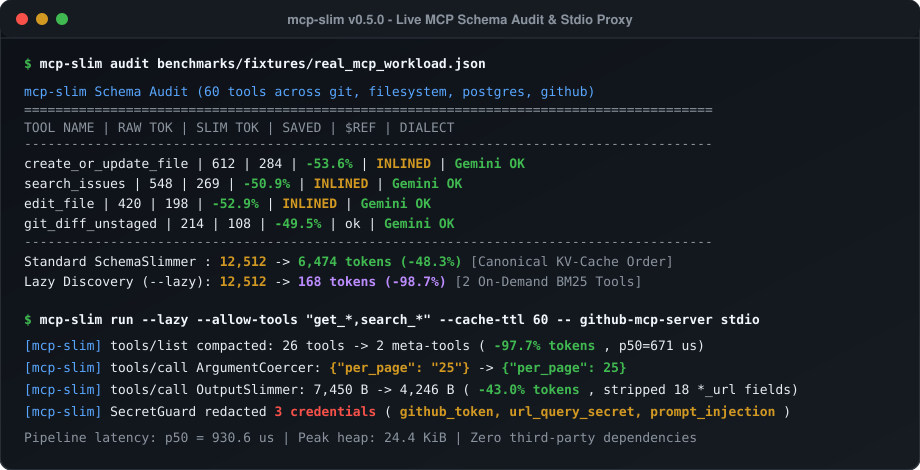
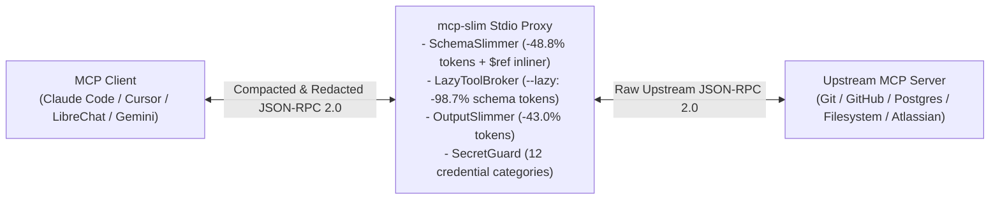
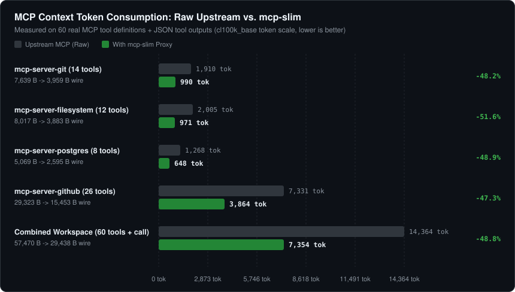
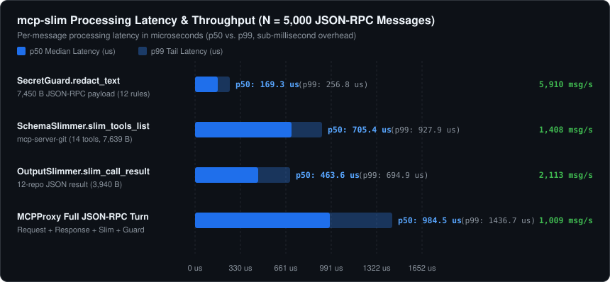

# mcp-slim

**Zero-Dependency MCP JSON-RPC 2.0 Stdio Proxy for Context Compression (-48.8% to -98.7% Tokens), Cross-LLM `$ref` Inlining, On-Demand Tool Discovery, and Real-Time Secret Redaction**

[](https://github.com/SalyyS1/mcp-slim/actions/workflows/ci.yml)
[](https://salyys1.github.io/mcp-slim/)
[](https://github.com/SalyyS1/mcp-slim/releases/tag/v0.8.0)
[](https://glama.ai/mcp/servers/SalyyS1/mcp-slim)
[](https://github.com/SalyyS1/mcp-slim)
[](https://github.com/SalyyS1/mcp-slim#installation--quick-start)
[](https://github.com/SalyyS1/mcp-slim/blob/main/pyproject.toml)
[](https://modelcontextprotocol.io)
[](https://github.com/SalyyS1/mcp-slim/blob/main/LICENSE)

> **Try Instantly in Your Browser (Zero Install, 100% Client-Side):** [**Interactive MCP Token & Security Playground (`https://salyys1.github.io/mcp-slim/`)**](https://salyys1.github.io/mcp-slim/): paste any `tools/list`, `tools/call`, or `mcp.json` config to preview token savings, `$defs/$ref` inlining, secret redaction, and monthly API USD savings live.



---

## Overview

When connecting MCP clients (**Claude Code**, **Cursor**, **Windsurf**, **Claude Desktop**, **LibreChat**, **Cherry Studio**, or custom agents) to multiple Model Context Protocol (MCP) servers (`git`, `filesystem`, `postgres`, `github`, `atlassian`, `slack`), three structural bottlenecks degrade agent reliability on every conversation turn:

1. **Context Window Bloat & Tool Selection Rot (14,000–60,000+ tokens per turn):** Auto-generated Pydantic and Zod `tools/list` JSON schemas include `$schema` declarations, redundant `title` fields, verbose multi-paragraph descriptions, nullable `anyOf: [{"type": "string"}, {"type": "null"}]` wrappers, and uncompacted `tools/call` JSON responses filled with `null`, `""`, `[]`, and `{}` entries.
2. **Cross-Provider Schema Rejections (`$defs` / `$ref`):** FastMCP and Pydantic servers emit nested `"$defs"` and `{"$ref": "#/$defs/..."}` pointers inside `inputSchema`, triggering `400 Invalid Argument` errors on Google Gemini, Vertex AI, Azure OpenAI, and local vLLM/Ollama function-calling endpoints.
3. **Unfiltered Credential Exposure:** MCP tools reading logs, `.env` files, database rows, or git remotes frequently return raw API keys (`sk-ant-...`, `ghp_...`, `AKIA...`, `xoxb-...`, JWTs, or database DSNs containing passwords) directly into the LLM context window.

`mcp-slim` is a transparent, zero-dependency Python 3.10+ stdio proxy that sits between any MCP client and upstream MCP server (`npx`, `uvx`, `python`, `docker`). It operates in two selectable modes:
- **Standard Mode (`mcp-slim run -- ...`):** Compacts all exposed `tools/list` schemas and `tools/call` payloads in-place by **47–52%**, inlines `$defs`/`$ref` pointers, and filters tools via exact names or wildcard globs (`--allow-tools "get_*,search_*"`).
- **Lazy Discovery Mode (`mcp-slim run --lazy -- ...`):** Replaces 40–100+ static tool definitions with 2 lightweight on-demand meta-tools (`mcp_search_tools` with BM25 ranking and `mcp_call_tool`), cutting static `tools/list` schema tokens from `12,512` to `168` (**-98.7%**) on any MCP client.



---

## Comparison with Existing Approaches

| Capability | Raw MCP Server | `mcp-filter` | Atlassian `mcp-compressor` | Claude Native `ToolSearch` | **`mcp-slim` (`v0.8.0`)** |
| :--- | :---: | :---: | :---: | :---: | :---: |
| **Runtime Dependencies** | Varies | Node.js | Python + deps | Built into Claude Code only | **0 (Pure Python 3.10+ stdlib)** |
| **Zero-Install `npx` & `uvx` Launchers** | Varies | `npx` only | `pip`/`uvx` | Built-in | **Yes (`npx -y github:SalyyS1/mcp-slim` & `uvx`)** |
| **Static `tools/list` Schema Minification** | No | No | Yes | No | **Yes (-48.3% to -57.4% tokens)** |
| **On-Demand Lazy Meta-Tool Discovery (`--lazy`)** | No | No | Yes | Client-locked | **Yes (-98.7% tokens, works on any client)** |
| **KV-Cache & Prompt-Cache Prefix Stabilization** | No | No | No | No | **Yes (Canonical tool & property sorting)** |
| **Schema-Guided Argument Type Coercion (`tools/call`)** | No | No | No | No | **Yes (Auto-coerces stringified int/float/bool/JSON)** |
| **Wildcard Glob & `--read-only` Policy (`ToolAnnotations`)** | No | Exact names | No | No | **Yes (`--allow-tools`, `--deny-tools`, `--read-only`)** |
| **`$defs`/`$ref` Inlining & Gemini/Vertex Dialect Normalization** | No | No | No | No | **Yes (Inlines `$ref`, flattens `anyOf`/`["T","null"]`, union guards)** |
| **`tools/call`, `resources/read` & `prompts/get` Compaction** | No | No | No | No | **Yes (-43%+ output tokens, preserves stack-trace head & tail)** |
| **Semantic Read-Only TTL Cache (`--cache-ttl`)** | No | No | No | No | **Yes (`readOnlyHint`/`destructiveHint` aware)** |
| **Pre-Truncation Tool-Poisoning, Unicode Smuggling & Secret Shield** | No | No | No | No | **Yes (15 rules + BiDi/Tag stripping + `--vault-handles`)** |
| **Persistent Token & API Cost Telemetry (`mcp-slim stats`)** | No | No | No | No | **Yes (Per-server ledger + model USD savings)** |
| **OASIS SARIF v2.1.0 Security Audit & CI GitHub Action** | No | No | No | No | **Yes (`audit --sarif --fail-on-security` & `SalyyS1/mcp-slim@main`)** |

---

## Performance & Compression Benchmarks

All benchmarks are reproducible via [`benchmarks/run_benchmarks.py`](./benchmarks/run_benchmarks.py) and `mcp-slim audit benchmarks/fixtures/real_mcp_workload.json` against [`benchmarks/fixtures/real_mcp_workload.json`](./benchmarks/fixtures/real_mcp_workload.json) (60 tool definitions across four standard MCP servers plus a 12-item GitHub repository search `tools/call` response containing leaked credentials).

### 1. Context Token & Wire-Byte Compression



| Workload | Tools | Raw Wire Bytes | Slim Wire Bytes | Tokens Before | Tokens After | Tokens Saved | Reduction |
| :--- | ---: | ---: | ---: | ---: | ---: | ---: | ---: |
| `mcp-server-git` | 14 | 7,639 B | 3,959 B | 1,910 | 990 | 920 | **-48.2%** |
| `mcp-server-filesystem` | 12 | 8,017 B | 3,883 B | 2,005 | 971 | 1,034 | **-51.6%** |
| `mcp-server-postgres` | 8 | 5,069 B | 2,595 B | 1,268 | 648 | 620 | **-48.9%** |
| `mcp-server-github` | 26 | 29,323 B | 15,453 B | 7,331 | 3,864 | 3,467 | **-47.3%** |
| **Combined Workspace (Standard Mode)** | **60** | **57,470 B** | **29,438 B** | **14,364** | **7,354** | **7,010** | **-48.8%** |
| **Combined `tools/list` (`--lazy` Discovery Mode)** | **60 -> 2** | **50,048 B** | **671 B** | **12,512** | **168** | **12,344** | **-98.7%** |

### 2. Runtime Latency, Throughput & Memory Footprint

Measured over **N = 5,000 iterations** on Python 3.11 (`linux x86_64`) using `time.perf_counter_ns()` and isolated `tracemalloc` allocation profiling:



| Pipeline Stage | Payload Size | p50 Latency | p95 Latency | p99 Latency | Throughput | Peak Heap Allocation |
| :--- | :--- | ---: | ---: | ---: | ---: | ---: |
| `SecretGuard.redact_text` | 7,450 B JSON-RPC payload | **141.2 µs** | 197.3 µs | 224.2 µs | **6,778 msg/s** (48.2 MB/s) | 22.2 KiB |
| `SchemaSlimmer.slim_tools_list` | 14 tools (7,639 B) | **671.1 µs** | 863.8 µs | 949.0 µs | **1,444 msg/s** (10.5 MB/s) | 4.7 KiB |
| `OutputSlimmer.slim_call_result` | 12-repo JSON output (7,450 B) | **462.7 µs** | 603.6 µs | 654.3 µs | **2,121 msg/s** (15.1 MB/s) | 17.1 KiB |
| `MCPProxy` Full JSON-RPC Turn | Request + Response + Slim + Guard | **930.6 µs** | 1,209.0 µs | 1,344.8 µs | **1,050 msg/s** (7.6 MB/s) | 24.4 KiB |

---

## Installation & Quick Start

> **No CLI setup needed to try it first:** Open the [**Interactive Browser Playground (`https://salyys1.github.io/mcp-slim/`)**](https://salyys1.github.io/mcp-slim/) to test live schema/output compression, `$defs/$ref` fixing, secret redaction, and 1-click `mcp.json` wrapping offline in your browser.

### 1. Run Immediately (Zero-Install `uvx` / `npx` or `pip install`)

`mcp-slim` requires Python 3.10+ and has **zero** third-party runtime dependencies. Run it directly via `uvx` or `npx` without installing anything globally, or install via `pip` / `uv`:

```bash
# Zero-install via uvx:
uvx --from git+https://github.com/SalyyS1/mcp-slim mcp-slim --benchmark
uvx --from git+https://github.com/SalyyS1/mcp-slim mcp-slim inspect -- npx -y @modelcontextprotocol/server-filesystem /tmp

# Zero-install via npx (for Cursor / Claude Desktop Node.js workflows):
npx -y github:SalyyS1/mcp-slim --benchmark
npx -y github:SalyyS1/mcp-slim wrap --runner npx -i ~/.cursor/mcp.json

# Or install persistently with pip / uv:
pip install git+https://github.com/SalyyS1/mcp-slim.git
uv tool install git+https://github.com/SalyyS1/mcp-slim.git
```

### 2. Wrap Existing MCP Configuration (`Standard` or `--lazy`)

Wrap all servers in a Claude Desktop, Claude Code, Cursor, or Windsurf configuration file with a single command:

```bash
# Standard schema slimming (-48.8% tokens):
mcp-slim wrap -i ~/.cursor/mcp.json

# Or enable On-Demand Lazy Discovery (-98.7% static schema tokens) and strict read-only policy:
mcp-slim wrap --lazy -i ~/.cursor/mcp.json
mcp-slim wrap --read-only -i ~/.cursor/mcp.json

# Zero-install config wrapping using uvx or npx runners directly inside mcp.json:
uvx --from git+https://github.com/SalyyS1/mcp-slim mcp-slim wrap --runner uvx -i ~/.cursor/mcp.json
npx -y github:SalyyS1/mcp-slim wrap --runner npx -i ~/.cursor/mcp.json
```

### 3. Inspect a Live MCP Server or Static Schema Manifest

Spawn any live MCP server over stdio, perform the JSON-RPC `initialize` + `tools/list` handshake automatically, and audit its token consumption without an LLM client:

```bash
# Live stdio server inspection (no chat session or API key required):
mcp-slim inspect -- npx -y @modelcontextprotocol/server-filesystem /tmp

# Or audit a static tools JSON manifest:
mcp-slim audit benchmarks/fixtures/real_mcp_workload.json
```

Output:
```text
mcp-slim Schema Audit (60 tools)
==============================================================================
TOOL NAME                        |   RAW TOK |  SLIM TOK |     SAVED |   $REF
------------------------------------------------------------------------------
git_status                       |        80 |        43 |    -46.2% |     ok
git_log                          |       272 |       108 |    -60.3% |     ok
read_file                        |       238 |       110 |    -53.8% |     ok
... (40 additional tools omitted from row listing)
------------------------------------------------------------------------------
Standard SchemaSlimmer : 12512 -> 6470 tokens (-48.3%, inlined 0 $ref definitions)
Lazy Discovery (--lazy): 12512 -> 168 tokens (-98.7% via 2 on-demand meta-tools)
==============================================================================
```

### 4. View Cumulative Token & API Cost Savings (`mcp-slim stats`)

Every `mcp-slim run` session atomically records token, wire-byte, reliability, and security counters in `~/.mcp-slim/stats.json` (disableable per session via `--no-stats` or globally via `MCP_SLIM_NO_STATS=1`):

```bash
mcp-slim stats            # Render interactive ASCII savings & model cost dashboard
mcp-slim stats --json     # Export machine-readable JSON telemetry summary
mcp-slim stats --reset    # Reset cumulative telemetry counters
```

Output:
```text
mcp-slim Cumulative Token & Cost Savings Dashboard
==============================================================================
Ledger File : ~/.mcp-slim/stats.json
Sessions    : 2   |   Last Updated : 2026-11-12T13:45:00Z
------------------------------------------------------------------------------
TRAFFIC STAGE                |       BEFORE |        AFTER |              SAVED
------------------------------------------------------------------------------
tools/list Schemas           |       25,024 |       12,940 |   12,084 (-48.3%)
tools/call Outputs           |        3,704 |        1,768 |    1,936 (-52.3%)
Total Context Tokens         |       28,728 |       14,708 |   14,020 (-48.8%)
JSON-RPC Wire Payload        |   112.25 KiB |    57.50 KiB | 54.75 KiB (-48.8%)
==============================================================================
Estimated API Input Cost Saved (Input-Rate Estimates)
MODEL (INPUT RATE)                   |  CUMULATIVE SAVED | 30D @ 100 TURNS/DAY
------------------------------------------------------------------------------
Claude Opus 4 ($15.00/1M)            |            $0.210 |         ~$315.45/mo
Claude Sonnet 4 ($3.00/1M)           |            $0.042 |          ~$63.09/mo
GPT-4o ($2.50/1M)                    |            $0.035 |          ~$52.58/mo
Gemini 2.5 Pro ($1.25/1M)            |            $0.018 |          ~$26.29/mo
==============================================================================
Reliability & Security Shield Counters
------------------------------------------------------------------------------
  $defs/$ref Pointers Inlined : 6           Read-Cache Hits     : 9
  Stringified Args Coerced    : 3           Secrets Redacted    : 4
  Policy-Blocked Tool Calls   : 0
==============================================================================
SERVER                         | SESSIONS |   RAW TOK |  SLIM TOK |    SAVED | SECRETS
------------------------------------------------------------------------------
@modelcontextprotocol/server-g |        1 |    16,510 |     8,612 |   -47.8% |       3
mcp-server-git                 |        1 |    12,218 |     6,096 |   -50.1% |       1
==============================================================================
```

### 5. CI Schema & Security SARIF Audit GitHub Action (`uses: SalyyS1/mcp-slim@main`)

Catch MCP context bloat, Gemini/Vertex AI `$defs`/`$ref` incompatibilities (`MS003`), embedded schema secrets (`MS002`), and tool-poisoning / Unicode smuggling payloads (`MS001`) automatically on pull requests, publishing both `$GITHUB_STEP_SUMMARY` tables and OASIS SARIF v2.1.0 reports for GitHub Code Scanning:

```yaml
name: MCP Schema & Security Audit
on: [push, pull_request]

jobs:
  mcp-audit:
    runs-on: ubuntu-latest
    permissions:
      contents: read
      security-events: write
    steps:
      - uses: actions/checkout@v4
      - name: Audit MCP Tool Schemas & Security
        uses: SalyyS1/mcp-slim@main
        with:
          manifest: benchmarks/fixtures/real_mcp_workload.json
          sarif-file: mcp-slim.sarif
          fail-on-security: "true"
      - uses: github/codeql-action/upload-sarif@v3
        if: always()
        with:
          sarif_file: mcp-slim.sarif
```

---

## Architecture & Optimization Passes

### 1. `SchemaSlimmer` (`tools/list`)
- **Recursive `$defs` / `$ref` Inlining:** Resolves local `#/$defs/...` and `#/definitions/...` JSON pointers inline and removes `$defs` blocks so Pydantic/FastMCP servers work without `400 Invalid Argument` errors on Google Gemini, Vertex AI, and Azure OpenAI.
- **Metadata Stripping:** Removes `$schema`, `$id`, `title`, `additionalProperties`, `examples`, and `default` fields that do not affect LLM tool invocation accuracy.
- **Nullable & Root-Union Normalization with Pre-Flight Branch Validation:** Rewrites `{"anyOf": [{"type": "string"}, {"type": "null"}]}` into `{"type": "string"}`, flattens root object `anyOf`/`oneOf` unions for strict providers while preserving compact disjunction hints (`[Requires one of: id | slug]`), and validates `tools/call` arguments against original `anyOf`/`oneOf` branch contracts at the proxy boundary (`--preserve-root-unions` keeps raw unions intact).
- **Redundant Description Pruning:** Drops parameter descriptions that merely restate the parameter identifier (`repo_path`: `"The path to the Git repository."`).
- **Sentence-Boundary Condensation:** Truncates multi-sentence descriptions to their primary clause (`--max-desc` and `--max-param-desc`).
- **Wildcard Glob Filtering with Fuzzy Typo Diagnostics:** Filter exposed tools via exact names or globs (`--allow-tools` / `--deny-tools`), with automatic Levenshtein suggestions when a policy entry matches zero upstream tools:

```bash
mcp-slim run --allow-tools "get_*,search_*,list_*" --deny-tools "*_delete_*" -- npx -y @modelcontextprotocol/server-github
```

### 2. `LazyToolBroker` (`--lazy` On-Demand Meta-Tool Discovery)
- Intercepts `tools/list`, indexes all allowed upstream tools in memory, and exposes only two compact meta-tools (`mcp_search_tools` and `mcp_call_tool`, `168` tokens total).
- Answers `mcp_search_tools(query, limit)` locally inside the proxy in `<0.1 ms` using BM25 ranking over tool names, descriptions, and parameter keys.
- Rewrites `mcp_call_tool(tool_name, arguments)` directly into native upstream `tools/call` JSON-RPC requests.

### 3. `OutputSlimmer`, Type Coercer & `ToolAnnotations` Policy (`tools/call`, `resources/read`, `prompts/get`)
- **Schema-Guided Argument Type Coercion:** Automatically coerces stringified integers (`"50"` -> `50`), floats, booleans (`"true"` -> `True`), and JSON arrays/objects in outgoing `tools/call` requests using the cached `inputSchema` from `tools/list`, preventing `-32602 ValidationError` failures on strict FastMCP/Pydantic servers when using local or quantized LLMs.
- **Full-Protocol Payload Compaction (`tools/call`, `resources/read`, `prompts/get`):** Compacts JSON strings, NDJSON streams, ANSI escape sequences, and padded Markdown tables across `tools/call` (`content[]`), `resources/read` (`contents[]`), and `prompts/get` (`messages[]`), pruning noisy REST hypermedia keys (`followers_url`, `gists_url`, `node_id`, etc.) while keeping truncated payloads **100% valid, parseable JSON**.
- **`ToolAnnotations`-Aware Semantic Cache & `--read-only` Mode:** Honors MCP `annotations.readOnlyHint` and `annotations.destructiveHint` (falling back to prefix heuristics when omitted) for `--cache-ttl <seconds>` read-cache routing and `--read-only` enforcement (`mcp-slim run --read-only` / `mcp-slim wrap --read-only`), preventing misleadingly named `get_*` mutators from being cached or executed.
- **UTF-16 Surrogate & ANSI Sanitization:** Strips terminal escape sequences and replaces lone UTF-16 surrogates (`\ud800`..`\udfff`) so malformed tool outputs never crash stdio streams.

### 4. Pre-Truncation `SecretGuard`, Unicode Smuggling Firewall & Vault Handles
Scans `tools/list` schemas *before* description truncation as well as outgoing `tools/call` arguments and incoming `tools/call`, `resources/read`, and `prompts/get` payloads across 15 credential and injection rules (`sk-ant-...`, `sk-proj-...`, `ghp_...`, `AKIA...`, `AIza...`, `xoxb-...`, `sk_live_...`, `hf_...`, PEM private keys, JWTs, idempotent URI/query/env framed secrets, and `<IMPORTANT>`/`<SYSTEM>`/`<INSTRUCTION>` tool-poisoning directives).
- **Unicode Tag & BiDi Smuggling Neutralization:** Strips invisible Unicode Tag characters (`U+E0000..U+E007F`) and bidirectional override/isolate controls (`U+202A..U+202E`, `U+2066..U+2069`) prior to injection matching so split tags (`<IMP\U000e0041ORTANT>`) or padded suffixes cannot evade truncation or regex triggers.
- **Session-Scoped Opaque Handles (`--vault-handles`):** Tokenizes intercepted secrets in server outputs into HMAC-keyed session handles (`[SECRET_REF:github_token:...]`) stored only in proxy memory so raw credentials never enter the LLM context window, while recursively resolving handles back to raw values across nested `tools/call` arguments on outbound calls.

### 5. Standalone MCP Server Mode (`mcp-slim serve`)
In addition to wrapping upstream servers via `mcp-slim run`, running `mcp-slim serve` (the default Docker `CMD`) exposes `compact_mcp_tools`, `audit_mcp_schema`, `redact_secrets`, and `get_slim_stats` directly over MCP JSON-RPC 2.0 stdio.

### 6. Local Unix Socket CLI Bridge & Shell Composition (`--bridge-socket` & `--cli-only`)
For coding agents (Claude Code, OpenCode, Aider, Cursor) that prefer invoking MCP tools from Bash and piping results through `jq`, `grep`, or `awk` without paying per-turn `tools/list` schema tokens:
- `--cli-only` returns an empty `tools: []` array to the host IDE (`0` schema tokens in the model prompt) while caching the compacted `inputSchema` definitions in memory.
- `--bridge-socket /tmp/mcp.sock` multiplexes `mcp-slim bridge` CLI commands directly over the single live stdio MCP server process:

```bash
# 1. Start the stdio proxy with a local bridge socket
mcp-slim run --cli-only --bridge-socket /tmp/mcp-github.sock -- npx -y @modelcontextprotocol/server-github

# 2. From any Bash session or agent skill:
mcp-slim bridge -s /tmp/mcp-github.sock                                      # 1-line list of tools
mcp-slim bridge -s /tmp/mcp-github.sock search_repositories --schema         # on-demand JSON Schema
mcp-slim bridge -s /tmp/mcp-github.sock search_repositories '{"query":"mcp"}' | jq '.items[0]'
```

---

## Testing

```bash
PYTHONPATH=src python3 -m unittest discover -s tests -v
python3 benchmarks/run_benchmarks.py
```

---

## Related AI Infrastructure Projects by [@SalyyS1](https://github.com/SalyyS1)

- **[loraspectra](https://github.com/SalyyS1/loraspectra)** - Zero-dependency Rust engine & CLI for auditing spectral rank collapse, dynamically compressing `.safetensors` LoRA adapters by **-83.8%** at **99% Frobenius energy**, and merging conflicting adapters via QR-Core Orthogonal Subspace Projection (`1,050x-2,680x` faster than dense SVD).

---

## License

Released under the [MIT License](./LICENSE).
